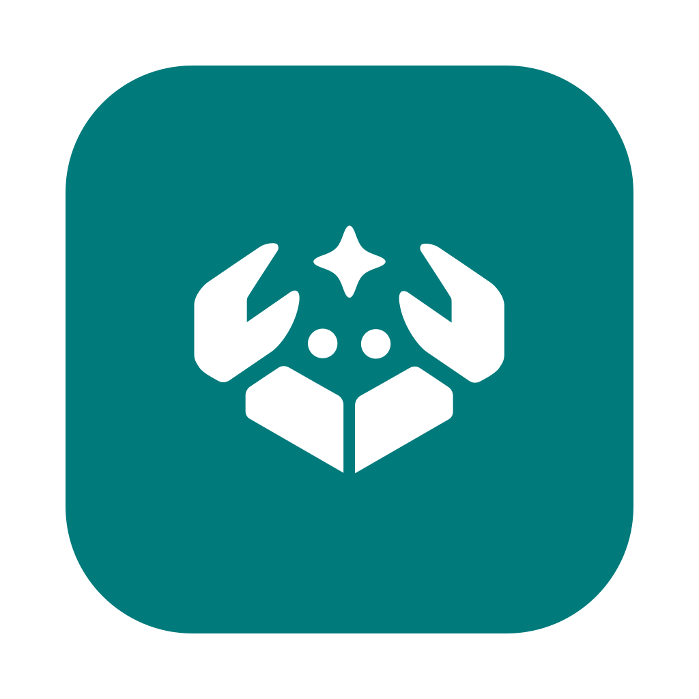

<p align="center">
  
</p>

<h1 align="center">Engclaw</h1>

<p align="center">
  <em>I couldn't afford an English course, so I built one that listens to me instead.<br>
  Turns out a very patient robot is cheaper than a tutor, and never sighs at my "th".</em>
</p>

<p align="center">
  <a href="https://github.com/pikann/engclaw/releases/latest/download/Engclaw-macOS-arm64.dmg"></a>
  <a href="https://github.com/pikann/engclaw/releases/latest/download/Engclaw-Windows-x64.exe"></a>
  <a href="https://github.com/pikann/engclaw/releases/latest/download/Engclaw-Linux-x64.AppImage"></a>
</p>

<p align="center">
  macOS Apple Silicon (.dmg) · Windows x64 (.exe) · Linux x64 (<a href="https://github.com/pikann/engclaw/releases/latest/download/Engclaw-Linux-x64.AppImage">AppImage</a> or <a href="https://github.com/pikann/engclaw/releases/latest/download/Engclaw-Linux-x64.deb">.deb</a>)<br>
  Other files and checksums: <a href="https://github.com/pikann/engclaw/releases/latest">all releases</a>
</p>

Engclaw is an open-source desktop app (macOS, Windows, Linux) for practising English pronunciation. It scores how you say a sentence against a reference, phone by phone, and lets you shadow YouTube videos. The UI is available in English and Vietnamese.

- **Practice**: read a sentence aloud or speak freely, then see which sounds, words and intonation to fix.
- **Shadowing**: repeat sentences from a YouTube video with a transcript, or test yourself with dictation.
- **Pronunciation game**: pass chapters one word at a time and collect stars.
- **Dictionary**: look up words with IPA, roots and word families, and study them as flashcards.
- **Converse** (optional): talk to an AI speaking-practice agent through a provider you configure.

## How the pronunciation check works

Engclaw does not ask a cloud service "does this sound OK?". It runs a stack of models on your computer and compares what you said with what you were supposed to say:

1. **Which sounds did you make?** A phone-recognition model (wav2vec2) listens to your recording and writes down the sounds it heard, as IPA phones, with no idea what you meant to say.
2. **Which sounds should you have made?** `espeak-ng` turns the target sentence into its expected phones.
3. **Compare.** The two phone sequences are aligned, and every mismatch is marked. This gives the phoneme error rate (PER) and the "words to fix" list.
4. **Which words did you say?** A second model transcribes your speech, which gives the word error rate (WER). If it hears a different word, that is a different word.
5. **Do you sound like it?** A reference voice (Kokoro) says the same sentence. Your audio and the reference are compared frame by frame with dynamic time warping, so speaking a bit slower or faster is fine, but different sounds are not.
6. **Intonation.** Pitch and energy curves are drawn for you and the reference.

The final score out of 100 is a weighted blend: **30% acoustic similarity, 40% correct sounds, 30% correct words.** The method is a TypeScript port of [OpenPronounce](https://github.com/Halleck45/OpenPronounce), checked against its Python output.

**Fair warning: it is strict, and it has no sense of charm.** A confident "mostly right" earns a mediocre score, a swallowed vowel is a wrong vowel, and a perfectly fluent sentence with one mumbled word still gets a red mark on that word. In the game, a try only counts when the score reaches 50 _and_ no word is flagged, so "close enough" does not pass. To clear a chapter, you really do have to pronounce it well. That is the point, but do not be surprised if the robot is harder to impress than your friends.

Scores are an aid, not an exam: a phone-level model can disagree with a human listener, especially for accents it has seen less of.

## Privacy

- **No server, no account, no telemetry.** Everything runs on your machine.
- Your recordings, history and settings are stored locally in the app data directory.
- The app only makes network requests when you ask it to: downloading models from Hugging Face on first use of a feature, fetching a YouTube video you choose, checking GitHub for updates (can be turned off), looking up a free illustration for dictionary words on Wikipedia and Wikimedia Commons (`en.wikipedia.org`, `commons.wikimedia.org`, `upload.wikimedia.org`, can be turned off), and, only if you set one up, your chosen AI provider. Only the word itself is sent to Wikimedia, with a generic Engclaw user agent. Pictures are cached locally.

The full list is also shown in the app under Settings → Privacy.

## Requirements and limitations

Please read this before installing; these are the honest limits of the current release.

|                      |                                                                                                                                                                                                                                                                                                        |
| -------------------- | ------------------------------------------------------------------------------------------------------------------------------------------------------------------------------------------------------------------------------------------------------------------------------------------------------ |
| **macOS**            | Apple Silicon (arm64) only. Intel Macs are not supported because `onnxruntime-node` ships no darwin/x64 binary.                                                                                                                                                                                        |
| **Windows**          | x64.                                                                                                                                                                                                                                                                                                   |
| **Linux**            | x64 (AppImage and `.deb`).                                                                                                                                                                                                                                                                             |
| **Disk space**       | About 2.6 GB for the speech models, plus the app itself (installer is under 250 MB).                                                                                                                                                                                                                   |
| **Memory**           | The models are large (the two wav2vec2 models are about 1.26 GB each as files). Plan for several GB of free RAM while scoring; models load on demand and unload when idle. We have not published formal minimum specs yet, so treat 8 GB as a practical starting point on a machine with a recent CPU. |
| **Speed**            | Scoring runs on your CPU, or on the GPU through WebGPU when available, with an automatic CPU fallback. The target is under about 3 seconds for a 5-second clip on a recent laptop. Older machines will be slower.                                                                                      |
| **Network**          | Needed once to download the models, and for YouTube, word illustrations, updates and the AI agent. Practice and the game work offline after the models are installed.                                                                                                                                  |
| **Language**         | Pronunciation scoring is English only. The interface is English and Vietnamese.                                                                                                                                                                                                                        |
| **Recording length** | Clips are limited to 15 minutes.                                                                                                                                                                                                                                                                       |

## Install

Use the download buttons at the top of this page (or pick a file from [GitHub Releases](https://github.com/pikann/engclaw/releases)). On first use of a scoring feature, Engclaw shows the model names, sizes and licenses and asks before downloading.

## Models

Models are not bundled or committed. They are downloaded from Hugging Face Hub the first time a feature needs them, verified by SHA-256 checksum, and stored in the app data directory (you can change the folder in Settings → AI models). The app uses a fixed set of models, pinned by revision in [`apps/desktop/resources/models.json`](apps/desktop/resources/models.json). There is no model picker.

| Model                                           | Used for                  | Download size | License    |
| ----------------------------------------------- | ------------------------- | ------------- | ---------- |
| Phone recognizer, `wav2vec2-lv-60-espeak-cv-ft` | Pronunciation, game       | about 1.26 GB | Apache-2.0 |
| Speech recognition, `wav2vec2-large-960h`       | Speaking freely, Converse | about 1.26 GB | Apache-2.0 |
| Reference voice, Kokoro-82M                     | Hear it, examples         | about 0.33 GB | Apache-2.0 |

Models run at original fp32 precision; int8 was tested and rejected because it changed the phone output too much. See [docs/model-export.md](docs/model-export.md) for how the ONNX files are produced.

## YouTube

Fetching captions and audio outside the official player may be against YouTube's Terms of Service. This feature is intended for personal, educational use only, and you are responsible for how you use it. Engclaw has no server that proxies YouTube; the requests are made from your own machine for the video you open. Engclaw is not affiliated with or endorsed by YouTube or Google. The extraction code is isolated in `packages/youtube` so it can be removed or replaced, and YouTube can change its behavior at any time, which may break the feature until the app is updated.

## Documentation

- [User guide](docs/user-guide.md): modes, shadowing, dictionary, game, settings, troubleshooting.
- [Contributing](CONTRIBUTING.md): set up, build, run and test; regenerate golden data; add a locale.
- [Architecture overview](docs/architecture.md): processes, packages and data flow.
- [Model export guide](docs/model-export.md): produce and publish the ONNX model files.

## Roadmap and community

Questions, ideas and show-and-tell go in [GitHub Discussions](https://github.com/pikann/engclaw/discussions). Bugs and feature requests go in [Issues](https://github.com/pikann/engclaw/issues). Security problems: [SECURITY.md](SECURITY.md).

Near-term focus: signed and auto-updating releases, accessibility and performance hardening, more interface languages, and more game content. Larger ideas are discussed in Discussions before they become issues; the roadmap there is a direction, not a promise.

## Build and run from source

Requirements: [Bun](https://bun.sh), a C compiler and CMake (to build the bundled `espeak-ng` once), and Node.js tooling that Electron needs. See [CONTRIBUTING.md](CONTRIBUTING.md) for the full walkthrough.

```bash
bun install
bun run dev        # start the app in development mode
bun run lint
bun run typecheck
bun run test
bun run package    # unpacked production build in apps/desktop/release
```

## Repository layout

- `apps/desktop`: Electron app (main process, renderer, utility process, e2e tests)
- `packages/*`: pronunciation scoring, prosody, YouTube adapter, IPC contract, i18n, models, dictionary, game
- `scripts`: build-time data pipelines, espeak-ng build, perf tools
- `tests`: cross-package tests and golden data

## License

Engclaw is licensed under the [GNU General Public License v3.0 or later](LICENSE) (`GPL-3.0-or-later`). It bundles the `espeak-ng` binary (GPL-3.0-or-later). Third-party notices are listed in [THIRD_PARTY_LICENSES.md](THIRD_PARTY_LICENSES.md) and in Settings → Licenses.

Engclaw's scoring algorithm is a TypeScript port of OpenPronounce, used under the MIT License. Dictionary data comes from Open English WordNet, CMUdict and Wiktionary-derived data (the latter under CC BY-SA 4.0). If you are a rights holder and want content removed, open an issue or contact the maintainers and it will be removed promptly.
